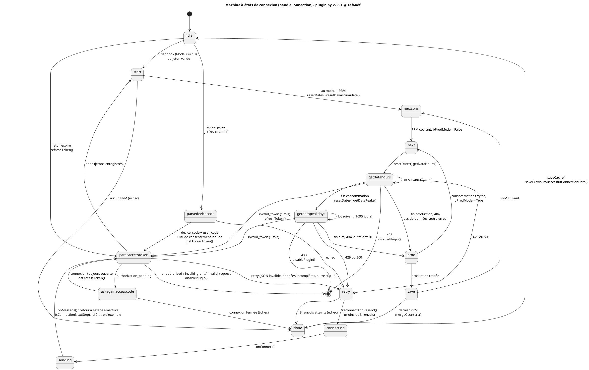

# Rétroconception technique du plugin Domoticz « Linky » (`plugin.py` v2.6.1, annotée v2.7.0)

> **Périmètre :** rétrodocumentation du code existant, rédigée **sans aucune modification de code** (plan d'action 009), puis **annotée pour la v2.7.0** (plan d'action 010 : correctifs S2/S3, tests, CI, provenance épinglée). Les § 1, 3 (effets de `Mode3`), 9.4, 11, 12, 13, 14 et 15 portent l'état **v2.7.0** ; les autres sections décrivent le comportement analysé à `1ef6adf`, inchangé en v2.7.0 sauf mention contraire.
> **Source analysée :** `plugin.py` version **2.6.1**, dépôt `vzwingma/DomoticzLinky`, branche `master`, commit **`1ef6adf`** (`1ef6adfd0fe0e1f6c78575a9d6d0100523341bc5`). **Version courante : 2.7.0** (branche `fix/v2.7.0`, voir [`CHANGELOG.md`](../CHANGELOG.md)).
> **Convention de référence :** les affirmations renvoient à un **nom de fonction** (`fonction()` = méthode de `BasePlugin`, ou fonction de module) de `plugin.py` v2.6.1 @ `1ef6adf`. Les numéros de ligne (`l.`) sont **indicatifs** (complément seulement) et valent pour ce SHA.
> **Langue :** français (décision du projet). Le guide utilisateur FR/EN reste dans [`readme.md`](../readme.md) et n'est pas dupliqué ici.
> **Rédaction :** 2026-11-25 (plan d'action 009 du dépôt `vzwingma/domotique`).

---

## Sommaire

1. [Identité et provenance](#1-identité-et-provenance)
2. [Contexte](#2-contexte)
3. [Paramètres du plugin](#3-paramètres-du-plugin)
4. [Carte du code](#4-carte-du-code)
5. [Machine à états de connexion](#5-machine-à-états-de-connexion)
6. [Authentification](#6-authentification)
7. [Collecte et traitement des données](#7-collecte-et-traitement-des-données)
8. [Dispositifs (devices) Domoticz](#8-dispositifs-devices-domoticz)
9. [Persistance](#9-persistance)
10. [Planification et résilience](#10-planification-et-résilience)
11. [Journalisation et debug](#11-journalisation-et-debug)
12. [Dépendances et compatibilité](#12-dépendances-et-compatibilité)
13. [Sécurité](#13-sécurité)
14. [Dette technique et risques](#14-dette-technique-et-risques)
15. [Intégration dans le projet `domotique`](#15-intégration-dans-le-projet-domotique)
16. [Glossaire](#16-glossaire)

---

## 1. Identité et provenance

| Élément | Valeur | Source |
|---|---|---|
| Clé du plugin | `key="linky"`, nom `Linky` | bloc XML `<plugin>` en tête de `plugin.py` (l. 25) |
| Version | `2.7.0` (analyse initiale : `2.6.1` @ `1ef6adf`, historique conservé) | bloc XML `<plugin>` ; envoyée aussi dans l'en-tête `User-Agent: DomoticzLinkyPlugin/<version>` (`initHeaders()`) |
| Auteur déclaré | `vzwingma` en v2.7.0 (`Barberousse` en v2.6.1) ; copyrights historiques conservés dans l'en-tête : Baptiste Candellier 2016, Asdepique777 2017, epierre 2017, Barberousse 2018-2021, vzwingma 2026- | en-tête de licence + attribut `author` |
| Licence du plugin | **AGPL-3.0** (en-tête de `plugin.py` + fichier `LICENSE`) | en-tête du fichier |
| Code tiers embarqué | classe `JoursFeries` issue de `etalab/jours-feries-france`, licence **MIT** (copyright Etalab 2020, texte de licence reproduit en commentaire) | classe `JoursFeries` (l. 2534 et suivantes) |
| `externallink` | `https://github.com/vzwingma/DomoticzLinky` (fork) en v2.7.0 ; `https://github.com/guillaumezin/DomoticzLinky` (dépôt d'origine) en v2.6.1 @ `1ef6adf` | bloc XML `<plugin>` |
| Dépôt d'origine (upstream) | `guillaumezin/DomoticzLinky` | readme, section Auteurs |
| Fork analysé | `vzwingma/DomoticzLinky` (remote `origin` du clone) | `.git/config` du clone |
| Code analysé | commit `1ef6adf` (v2.6.1), identique à l'upstream `guillaumezin/DomoticzLinky` (`master`). `plugin.py` est **inchangé** dans le tag `v2.6.1` du fork (commit documentaire `f3df258`) | `git diff 1ef6adf f3df258 -- plugin.py` (vide) |
| Tag | `v2.6.1` (fork `vzwingma/DomoticzLinky`, sur le commit documentaire `f3df258`) ; le code de référence reste identifié par le SHA `1ef6adf`. `v2.7.0` : tag posé sur le commit de merge de la branche `fix/v2.7.0` (publication par le mainteneur, plan 010 T4.2) | tags du fork |

### Statut de maintenance

**Fork maintenu par vzwingma ; upstream `guillaumezin/DomoticzLinky` non maintenu (l'auteur n'utilise plus Domoticz).**

> ✅ **Provenance épinglée :** le projet `domotique` construit son image à partir de **ce fork** (`vzwingma/DomoticzLinky`), **épinglé par SHA de commit** avec le tag en commentaire (`ref: <sha> # <tag>` dans `build-domoticz.yml`) — pin initial `v2.6.1` (commit `f3df258`), montée vers `v2.7.0` après publication du tag. Les montées de version arrivent par PR Renovate **sans automerge** (relue et fusionnée à la main). Décision : [ADR 007 du dépôt `domotique`](https://github.com/vzwingma/domotique/blob/master/docs/adr/007-plugins-domoticz-provenance-epinglee.md) ; détail : [§ 15](#15-intégration-dans-le-projet-domotique). L'identité du code analysé (`1ef6adf`, identique à l'upstream `master` à la date de la rétrodoc, constat transmis par le pilote du plan) reste une référence **historique** : l'upstream n'est plus consommé.

Fichiers du dépôt : `plugin.py` (monolithe, ≈ 2 776 lignes en v2.7.0 ; ≈ 2 727 à `1ef6adf`), `readme.md` (guide utilisateur FR + EN), `CHANGELOG.md`, `LICENSE`, `assets/` (captures d'écran du guide), `tests/` (suite pytest avec faux module `Domoticz`), `requirements-dev.txt` (`pytest`, `ruff`), `ruff.toml`, `.gitignore`, `.github/` (`FUNDING.yml`, `ISSUE_TEMPLATE.md`, `workflows/ci.yml` — CI GitHub Actions sur Python 3.11 et 3.13). Aucun `.py` à la racine autre que `plugin.py` (seul fichier embarqué dans l'image).

---

## 2. Contexte

### 2.1 Framework de plugins Python de Domoticz

Le plugin s'exécute dans le **framework de plugins Python** de Domoticz (module `Domoticz` injecté, dictionnaires globaux `Parameters` et `Devices`). Domoticz appelle des **callbacks de module** (`onStart`, `onStop`, `onConnect`, `onMessage`, `onHeartbeat`, `onDisconnect`, …) qui délèguent à une instance unique `_plugin = BasePlugin()` (fonctions de module en fin de fichier, l. 2360-2414), **à l'exception de `onDeviceAdded`, `onDeviceModified` et `onDeviceRemoved`**, qui sont des callbacks **vides** (simple `global _plugin`, aucune délégation). Les connexions réseau sont **asynchrones** (`Domoticz.Connection(...).Connect()` puis `onConnect` → `Send()` → `onMessage`) : toute la logique est donc écrite comme une **machine à états** ([§ 5](#5-machine-à-états-de-connexion)).

### 2.2 Enedis Data Connect et proxy d'authentification

- Les données proviennent de l'API **Enedis Data Connect** (comptes **particuliers** uniquement, limite d'API rappelée dans le readme).
- L'accès Enedis exige un consentement OAuth2 de l'utilisateur. Le plugin **n'appelle pas Enedis directement** : il passe par un **proxy tiers** (« Device Flow Proxy Server », hébergé par RUSSANDOL, cf. readme « Remerciements ») qui détient le contrat Enedis et relaie les requêtes d'authentification et de données (`LOGIN_BASE_URI`, `API_BASE_URI`, `API_ENDPOINT_DATA_URI`).
- Deux couples d'adresses sont codés en dur (index `iAlternateAddress`) : `[0]` = **production** (`enedis.domoticz.russandol.pro`), `[1]` = **sandbox** (`opensrcdev.alwaysdata.net`, préfixe de chemin `/domoticzlinkyconnect`). Le mode sandbox n'est activé que par `Mode3` ≥ 10 ([§ 3](#3-paramètres-du-plugin)).

> Sources : constantes `CLIENT_ID`, `LOGIN_BASE_URI`, `API_BASE_URI`, `API_ENDPOINT_*` (l. 137-153) ; callbacks de module (l. 2360-2414).

---

## 3. Paramètres du plugin

Déclarés dans le bloc XML `<params>` (l. 26-112) et lus dans `onStart()`.

| Champ | Rôle | Valeurs / bornes | Défaut | Traitement dans `onStart()` |
|---|---|---|---|---|
| `Mode1` | Jours récupérés pour la **vue par heures** | entier **0 à 7** | `7` | `int()` ; erreur de conversion → `7` ; `< 0` → `0` ; `> 7` → `7`. `0` désactive l'écriture des valeurs horaires dans le dispositif (test `iHistoryDaysForHoursView > 0` dans `saveDataToDb()`). |
| `Mode2` | Jours récupérés pour les **autres vues** (jour/semaine/mois/année) | entier **2 à 730** | `7` | erreur de conversion → `7` ; `< 2` → `2` ; `> 730` → `730`. Relevé à un **minimum** selon `Mode6` : `_cweek` → 7, `_lweek` → 14, `_cmonth` → 32, `_lmonth` → 63, `_year` → 366. Au-delà de 35 j, logique d'historique court/complet ([§ 7.4](#74-historique-court-et-complet)). |
| `Mode3` | **Debug / maintenance** | `0` non · `1` simple · `2` avancé · `3` **reset consentement** · `4` **reset cache** · `10` à `19` **faux clients** (sandbox) | `0` | `int()` ; erreur → `0`. Détails ci-dessous. |
| `Mode4` | **Plages d'heures creuses (HC)** | texte libre (syntaxe : readme § « Heures creuses ») | vide = désactivé | `parseHcParameter()` ([§ 7.5](#75-heures-creuses-hchp-et-jours-fériés)) |
| `Port` | **Ordre des index** | `0` = heures pleines (HP) puis HC ; `1` = HC puis HP | `0` | `bOffPeakFirst = (Port == "1")` ; inversion **à l'écriture** dans `addToDevice()` / `updateDevice()` (l'historique déjà écrit n'est pas modifié, cf. readme). Le champ `Port` est réutilisé pour stocker un choix d'index (ce n'est pas un port réseau). |
| `Mode5` | **Affichage principal** du tableau de bord | `peak_day`, `peak_cweek`, `peak_lweek`, `peak_cmonth`, `peak_lmonth`, `peak_year` (pic de consommation) | aucun défaut XML ; repli code `peak_day` | Alimente les champs « CONS;PROD » de `sValue` (cf. [§ 8](#8-dispositifs-devices-domoticz)). Fixe la durée de récupération des pics : `_cweek` 7 j, `_lweek` 14 j, `_cmonth` 32 j, `_lmonth` 63 j, `_year` 366 j, sinon 1 j (`iHistoryDaysForPeakDaysView`). |
| `Mode6` | **Affichage secondaire** du tableau de bord | `value_*` (somme), `max_*` (maximum horaire), `mean_*` (moyenne horaire) × `day`, `cweek`, `lweek`, `cmonth` (les variantes `lmonth`/`year` sont **commentées** dans le XML) | `value_day` | Alimente les compteurs U1/U2/R1/R2 de `sValue`. Repli code : `value_day`. |
| `Username`, `Password` | **supprimés** | — | — | `Parameters.pop("Username"/"Password")` : évite un en-tête HTTP Basic indésirable avec d'anciennes bases. |

### Effets de `Mode3`

| Valeur | Effet (`onStart()`) |
|---|---|
| `0` | Aucun debug. |
| `1` | Crée un fichier de log temporaire ([§ 11](#11-journalisation-et-debug)) ; `dumpDictToLog()` actif (fichier seulement). |
| `2` | Idem + `Domoticz.Debugging(1)` (⚠️ log du framework Domoticz **non masqué**, voir D17 / [§ 13](#13-sécurité) S9) + messages de debug recopiés dans le log Domoticz (`myMessage()`). |
| `3` | `resetTokens()` à **chaque démarrage** tant que la valeur reste à 3 → nouveau consentement requis. Active aussi le debug avancé (niveau > 1). |
| `4` | `resetCache()` à chaque démarrage (vide `cache` et `cache_checksum`). Active aussi le debug avancé. |
| `10` à `18` | **Sandbox** : `iAlternateAddress = 1`, liste `lFalseCustomer` prédéfinie (1 à 3 faux PRM selon la valeur) ; l'étape `idle` saute l'authentification. Debug avancé actif. |
| `19` (« Faux client 9 ») | Active la sandbox **mais aucune liste n'est définie** (la chaîne `if/elif` s'arrête à 18) → `lFalseCustomer` reste vide → erreur « Erreur à la lecture des points de livraison » à l'étape `start`. |

> Sources : bloc XML `<params>` ; `onStart()` ; `parseHcParameter()` ; `resetTokens()` ; `resetCache()`.

---

## 4. Carte du code

`plugin.py` est un **fichier unique** organisé en une classe `BasePlugin` (l. 164 à ≈ 2358), des wrappers de callbacks, des fonctions utilitaires et la classe embarquée `JoursFeries`.

| Zone | Lignes (indicatif) | Contenu principal |
|---|---|---|
| En-tête + XML | 1-113 | Licence AGPL, bloc `<plugin>` et `<params>` |
| Imports et constantes | 118-162 | `CLIENT_ID`, URI/ports/endpoints, `HEADERS`, `USAGE_POINT_SEPARATOR = " / "`, `NB_WEEKS_LONG_HISTORY = 5`, `NO_STATUS_ERROR_CODE = 999` |
| État de la classe | 164-305 | Attributs de classe (étape courante, dates de lots, compteurs de renvoi, dictionnaires `dData`, `dHc`, `dCalculate`…) |
| Journalisation | 323-350 | `myMessage()`, `myLog()`, `myDebug()`, `myStatus()`, `myError()` |
| Transport HTTP | 353-415 | `reconnectAndResend()`, `connectAndSend()`, `connectAndSendForAuthorize()`, `connectAndSendForMetering()`, `initHeaders()` |
| Authentification | 417-604 | `getDeviceCode()`, `parseDeviceCode()`, `getAccessToken()`, `refreshToken()`, `parseAccessToken()` |
| Requête de données | 606-630 | `getData()` |
| Dispositifs Domoticz | 632-695 | `getOrCreateDevice()`, `addToDevice()`, `updateDevice()` |
| Messages d'erreur | 438-466, 697-722 | `showStatusError()`, `showSimpleStatusError()`, `showStepError()`, `showSimpleStepError()` |
| HC/HP | 724-880 | `parseHcParameter()`, `isCost2()`, `has2Costs()` |
| Écriture en base | 881-1086 | `saveDataToDb()`, `mergeCounters()` |
| Stockage et lecture JSON | 1088-1187, 1265-1316 | `storeData()`, `exploreDataHours()`, `exploreDataPeaks()` |
| Calculs tableau de bord | 1189-1263, 1318-1414 | `resetCalculate()`, `resetDayAccumulate()`, `modifyCalculation()`, `doCalculation()`, `dayAccumulate*()`, `updateDashboard()` |
| Dates, lots, planification | 1416-1585 | `resetDates()`, `calculateDaysLeft()`, `stillDays()`, `setHistoryDays()`, `savePreviousSuccessfulConnectionDate()`, `setNextConnection()`, `setNextConnectionForLater()`, `clearData()`, `clearState()`, `disablePlugin()` |
| Cache « pas de données » et cache mémoire | 1588-1685 | `setCacheEmpty()`, `getCacheNoData()`, `getDataHours()`, `getDataPeaks()` |
| **Machine à états** | 1687-1964 | `handleConnection()` |
| Debug | 1967-1985 | `dumpDictToLog()` |
| Callbacks de la classe | 1987-2244 | `onStart()`, `onStop()`, `onConnect()`, `onMessage()`, `onDisconnect()`, `onHeartbeat()` |
| Persistance | 2246-2361 | `getConfigItemAndChecksum()`, `getConfigItem()`, `setConfigItem()`, `resetTokens()`, `resetCache()`, `saveCache()`, `loadCache()` |
| Wrappers de callbacks Domoticz | 2360-2414 | `_plugin = BasePlugin()` et fonctions `onStart()`…`onHeartbeat()` de module |
| Utilitaires | 2417-2522 | `setTimeout()`, `setRefreshTime()`, `initState()`, `initData()`, `dictToQuotedString()`, `getError()`, `getStatus()`, conversions de dates |
| `JoursFeries` (MIT, Etalab) | 2534-2727 | Calcul des jours fériés (zone Métropole par défaut) |

### Structures de données en mémoire

| Structure | Contenu |
|---|---|
| `dData[PRM]["data"][AAAA-MM-JJ]` | Par jour (`initData()`) : `consumption1_hours`, `consumption2_hours`, `production1_hours`, `production2_hours` (dictionnaires heure → valeur), `consumptionpeak`, `productionpeak`, indicateurs `hasconsoprod` / `haspeak`, dates `consoproddate` / `peakdate` |
| `dData[PRM]["state"]` | `noConsumption`, `noProduction` (cache négatif, `initState()`) |
| `dHc[PRM ou "all"]["prod" ou "all"][jour 0-6, 7 ou 8]` | Plages HC (liste `[heure début, heure fin]`) ; `7` = tous les jours, `8` = jours fériés |
| `dCalculate[PRM][consumption1\|2, production1\|2, consumptionpeak, productionpeak]` | Agrégats `value_/max_/counter_/mean_` × `day`, `cweek`, `lweek`, `cmonth`, `lmonth`, `year` (`modifyCalculation()`) |

> Note : `consumption2_hours` n'est **jamais alimenté** par `storeData()` ; la ventilation HP/HC est faite à l'écriture dans `saveDataToDb()` (commentaire « We will handle cost 1 and 2 when putting data in db instead »).

---

## 5. Machine à états de connexion

La variable `sConnectionStep` pilote `handleConnection()`, appelée depuis `onHeartbeat()`, `onMessage()` et `onConnect()`. Les étapes de collecte s'enchaînent dans une même invocation (blocs `if`, et non `elif`, après le premier jeu de `elif`).

### 5.1 Diagramme

> Les étapes **transitoires** `connecting` / `sending` encapsulent une requête HTTP : `connectAndSend()` mémorise l'étape émettrice dans `sConnectionNextStep` ; `onMessage()` la restaure avant d'appeler `handleConnection(Data)`. Le diagramme ne montre qu'une flèche de retour, par lisibilité : la réponse revient à **l'étape qui a émis la requête** (`parsedevicecode`, `parseaccesstoken`, `getdatahours`, `getdatapeakdays`). L'étape `nothingtosend` (« Erreur à la connexion », → `done` en échec) n'est pas représentée : elle ne survient que si `onConnect()` n'a rien à envoyer.

### 5.2 Table des transitions

| État source | Condition / déclencheur | Action | État cible | Fonction |
|---|---|---|---|---|
| `idle` | toujours | `setHistoryDays()`, `clearState()` | selon lignes suivantes | `handleConnection()` |
| `idle` | sandbox (`iAlternateAddress`) | — | `start` | `handleConnection()` |
| `idle` | `expires_at` > 2000-01-01 et maintenant < `expires_at` − 10 min | — | `start` | `handleConnection()` |
| `idle` | `expires_at` > 2000-01-01 et jeton expiré | `refreshToken()` | `parseaccesstoken` | `handleConnection()` |
| `idle` | pas d'`expires_at` (jamais consenti / reset) | `getDeviceCode()` | `parsedevicecode` | `handleConnection()` |
| `parsedevicecode` | réponse 200 avec `device_code` + `user_code` | log de l'URL + code ; `getAccessToken()` | `parseaccesstoken` | `parseDeviceCode()` |
| `parsedevicecode` | autre réponse | message d'erreur ; `setNextConnectionForLater(iInterval)` | `retry` | `parseDeviceCode()` |
| `parseaccesstoken` | résultat `done` (4 champs reçus) | jetons enregistrés | `start` | `parseAccessToken()` |
| `parseaccesstoken` | `authorization_pending` | `iInterval` ← `interval` reçu (défaut 5) ; `setNextConnectionForLater(iInterval)` | `askagainaccesscode` | `parseAccessToken()` |
| `parseaccesstoken` | résultat `retry` (200 incomplet « Pas assez de données reçue » / « Pas de données reçue », ou autre statut) | `setNextConnectionForLater(iInterval)` | `retry` | `parseAccessToken()` |
| `parseaccesstoken` | `authorization_pending` **avec corps non JSON** (`ValueError`) — ou réponse 200 non JSON | message « Les données reçues ne sont pas du JSON » ; retour `retry` (et non `pending`) ; `setNextConnectionForLater(iInterval)` | `retry` | `parseAccessToken()` |
| `parseaccesstoken` | `unauthorized` / `invalid_grant` / `invalid_request` | `disablePlugin()` | arrêt (`isStarted = False`) | `parseAccessToken()` |
| `askagainaccesscode` | `httpLoginConn.Connected()` vrai | `getAccessToken()` | `parseaccesstoken` | `handleConnection()` |
| `askagainaccesscode` | connexion fermée | message « Redemande du jeton d'accès » ; `bHasAFail` | `done` | `handleConnection()` |
| `start` | ≥ 1 PRM (`usage_points_id` ou `lFalseCustomer`) | `resetDates(aujourd'hui 00:00)`, `resetDayAccumulate()` | `nextcons` | `handleConnection()` |
| `start` | 0 PRM | erreur « Erreur à la lecture des points de livraison » ; `bHasAFail` | `done` | `handleConnection()` |
| `nextcons` | — | `sUsagePointId` ← PRM courant (majuscules) ; si `bHasAFail` : `bGlobalHasAFail = True` puis `bHasAFail = False` (propagation de l'échec du PRM précédent) ; `bProdMode = False` ; `bNoConsumption/bNoProduction = False` | `next` | `handleConnection()` |
| `next` | — | `resetDates()` ; `getDataHours()` (cache ou requête) | `getdatahours` | `handleConnection()` |
| `getdatahours` | `invalid_token` et `bRefreshToken` faux | `refreshToken()` | `parseaccesstoken` | `handleConnection()` |
| `getdatahours` | statut 403 | `disablePlugin()` | arrêt | `handleConnection()` |
| `getdatahours` | cache « pas de données », 404 ; en **production** aussi 400, 500 ou `ADAM-ERR0123` | marque `bNoConsumption`/`bNoProduction` (1er lot) ; cache négatif si `ADAM-ERR0069`/`0123` | `prod` | `handleConnection()` |
| `getdatahours` | 429 ou 500 (consommation) | `setNextConnectionForLater(iInterval)` | `retry` | `handleConnection()` |
| `getdatahours` | autre statut ≠ 200 | erreur ; `bHasAFail` | `prod` | `handleConnection()` |
| `getdatahours` | 200 et jours restants | `exploreDataHours()` ; `calculateDaysLeft()` ; `getDataHours()` | `getdatahours` (lot suivant) | `handleConnection()` |
| `getdatahours` | 200, plus de jours, mode production | `exploreDataHours()` | `prod` | `handleConnection()` |
| `getdatahours` | 200, plus de jours, mode consommation | `exploreDataHours()` ; `resetDates()` ; `getDataPeaks()` | `getdatapeakdays` | `handleConnection()` |
| `getdatapeakdays` | mêmes cas `invalid_token`, 403, 429/500 | comme `getdatahours` | `parseaccesstoken` / arrêt / `retry` | `handleConnection()` |
| `getdatapeakdays` | cache « pas de données » ou 404 | message en debug seulement | `prod` | `handleConnection()` |
| `getdatapeakdays` | autre statut ≠ 200 | erreur ; `bHasAFail` | `prod` | `handleConnection()` |
| `getdatapeakdays` | 200 | `exploreDataPeaks()` ; lot suivant si `iDaysLeft` > 0 | `getdatapeakdays` ou `prod` | `handleConnection()` |
| `prod` | production non traitée | `bProdMode = True` | `next` | `handleConnection()` |
| `prod` | production déjà traitée | — | `save` | `handleConnection()` |
| `save` | — | `saveDataToDb()` ; `iUsagePointIndex` + 1 | `nextcons` (PRM suivant) ou `done` | `handleConnection()` |
| `save` | dernier PRM | `mergeCounters()` | `done` | `handleConnection()` |
| `done` | — | `setNextConnection(False)` si échec global ; `saveCache()` ; `savePreviousSuccessfulConnectionDate()` ; `clearState()` | `idle` | `handleConnection()` |
| (toute requête) | ≥ 5 s depuis la dernière connexion | ouvre la connexion HTTPS | `connecting` | `connectAndSend()` |
| (toute requête) | < 5 s depuis la dernière connexion | `setNextConnectionForLater(iInterval)` | `retry` | `connectAndSend()` |
| `connecting` | `onConnect()` avec tampon | `Connection.Send()` | `sending` | `onConnect()` |
| `sending` | `onMessage()` | restaure `sConnectionNextStep` ; `handleConnection(Data)` | étape émettrice | `onMessage()` |
| `connecting` / `sending` | heartbeat sans réponse (`iTimeoutCount` ≥ 3) | `setNextConnectionForLater(iInterval)` | `retry` | `handleConnection()` |
| `retry` | `iResendCount` < 3 | `reconnectAndResend()` (réémet le dernier message) | `connecting` | `handleConnection()` |
| `retry` | `iResendCount` ≥ 3 | message « Trop d'échecs de communication… » ; `bHasAFail` | `done` | `handleConnection()` |
| toute étape appelant `setNextConnectionForLater()` | heure calculée hors 8 h-22 h | prochaine connexion lendemain 8 h + aléa (ou 8 h le jour même si < 8 h) | `idle` | `setNextConnectionForLater()` |

> Sources : `handleConnection()`, `connectAndSend()`, `reconnectAndResend()`, `onConnect()`, `onMessage()`, `onHeartbeat()`, `parseDeviceCode()`, `parseAccessToken()`, `disablePlugin()`.

---

## 6. Authentification

Flux **OAuth2 Device Flow** via le proxy ([§ 2.2](#22-enedis-data-connect-et-proxy-dauthentification)). Le `client_id` est **public** et codé en dur (deux valeurs : production `[0]`, sandbox `[1]`).

1. **Demande de code** — `getDeviceCode()` : `POST <login>/device/code` avec `client_id`. En sandbox, chemins préfixés `/domoticzlinkyconnect`.
2. **Consentement** — `parseDeviceCode()` : sur 200 avec `device_code` + `user_code`, le plugin écrit **dans le log d'erreur Domoticz** (`myError()`) : « Connectez-vous à l'adresse `<URL>/device?code=<user_code>` … avec le code `<user_code>` ». L'utilisateur ouvre l'URL et s'authentifie chez Enedis.
3. **Attente** — `getAccessToken()` : `POST <login>/device/token` avec `grant_type=urn:ietf:params:oauth:grant-type:device_code` et `device_code`. Tant que la réponse est `authorization_pending`, `parseAccessToken()` met à jour `iInterval` (champ `interval`, 5 s par défaut) et l'étape passe par `askagainaccesscode` ; la **connexion de login doit rester ouverte**, sinon échec de la tentative (`bHasAFail`).
4. **Enregistrement** — réponse 200 : `parseAccessToken()` enregistre (via `setConfigItem()`) `usage_points_id` (liste, séparée par des virgules dans la réponse), `refresh_token`, `access_token`, `token_type` et `expires_at`. Il faut **4 champs** (`refresh_token`, `access_token`, `token_type`, `expires_in`) pour conclure `done`, sinon « Pas assez de données reçue » → `retry`.
5. **Expiration** — `expires_at = maintenant + expires_in − 10 min` (`parseAccessToken()`). À l'étape `idle`, un jeton n'est réutilisé que si `maintenant < expires_at − 10 min` : la **marge effective est donc de 20 minutes**.
6. **Rafraîchissement** — `refreshToken()` : `POST <login>/device/token` avec `grant_type=refresh_token`, `client_id`, `usage_points_id` (liste jointe par virgules) et `refresh_token`. Déclenché soit à `idle` (jeton expiré), soit quand une réponse de données contient l'erreur `invalid_token` (une seule fois par cycle grâce à `bRefreshToken`). Après un rafraîchissement réussi, la collecte **repart de `start`**.
7. **Fin de consentement / erreurs fatales** :
   - `parseAccessToken()` : erreur `unauthorized`, `invalid_grant` ou `invalid_request` → `disablePlugin()`.
   - `getdatahours` / `getdatapeakdays` : statut **403** → `disablePlugin()`.
   - `disablePlugin()` : `isStarted = False`, `resetTokens()` (effacement de `usage_points_id`, `token_type`, `refresh_token`, `access_token`, `expires_at`), tous les dispositifs passent en `TimedOut`, message d'erreur demandant de relancer le matériel (Configuration → Matériel → Modifier) et de surveiller le log pour le nouveau lien de consentement.
8. **Appels de données** — `getData()` ajoute l'en-tête `Authorization: <token_type> <access_token>` et les paramètres `start`, `end` (format `AAAA-MM-JJ`) et `usage_point_id`.

> Sources : `getDeviceCode()`, `parseDeviceCode()`, `getAccessToken()`, `parseAccessToken()`, `refreshToken()`, `getData()`, `disablePlugin()`, `resetTokens()`, `handleConnection()` (étape `idle`).

---

## 7. Collecte et traitement des données

### 7.1 Endpoints appelés (via le proxy, préfixe `/data/proxy`)

| Donnée | Endpoint (constante) | Usage |
|---|---|---|
| Courbe de charge — consommation | `/metering_data_clc/v5/consumption_load_curve` (`API_ENDPOINT_DATA_CONSUMPTION_LOAD_CURVE`) | Valeurs au pas de 30 min → agrégées à l'heure |
| Courbe de charge — production | `/metering_data_plc/v5/production_load_curve` (`API_ENDPOINT_DATA_PRODUCTION_LOAD_CURVE`) | Idem, en mode production |
| Puissance maximale journalière | `/metering_data_dcmp/v5/daily_consumption_max_power` (`API_ENDPOINT_DATA_CONSUMPTION_MAX_POWER`) | « Pics » de consommation ; **pas d'équivalent production** (commentaire « No production peak available yet in Enedis API ») |
| Consommation / production quotidienne | `/metering_data_dc/v5/daily_consumption`, `/metering_data_dp/v5/daily_production` | **Déclarés mais jamais utilisés** |

### 7.2 Séquence par PRM

Pour chaque PRM (`nextcons`) : consommation horaire (`clc`) par lots, puis pics (`dcmp`), puis production horaire (`plc`), puis `saveDataToDb()`. Après le dernier PRM, `mergeCounters()`.

### 7.3 Découpage en lots

| Type | Taille de lot | Volume total | Fonction |
|---|---|---|---|
| Horaire (`clc` / `plc`) | **7 jours** par requête | `max(Mode1, Mode2)` jours (`Mode2` borné à 35 j en historique court) | `resetDates()`, `calculateDaysLeft()` |
| Pics (`dcmp`) | **1095 jours** par requête | durée liée à `Mode5` (1, 7, 14, 32, 63 ou 366 j) | `resetDates()`, `calculateDaysLeft()` |

Le premier lot se termine à **aujourd'hui 00:00** et les lots suivants remontent dans le temps (`savedDateEndDays*`). Les journées sont donc calculées **à partir des données horaires** : `Mode2` pilote la quantité de données horaires récupérées, pas un appel « quotidien ».

### 7.4 Historique court et complet

`setHistoryDays()` (appelée à chaque passage par `idle`) :

- **Historique complet** si `Mode2` (valeur sauvegardée `iSavedHistoryDaysForDaysView`) > **35 jours** (`NB_WEEKS_LONG_HISTORY` × 7) **et** l'une des conditions suivantes : `Mode2` modifié depuis le dernier démarrage (`bHistoryDaysForDaysViewChanged`), `next_history_grab_date` atteinte, ou dernière connexion réussie + `Mode2` jours dépassée.
- Sinon **historique court** : `iHistoryDaysForDaysView` plafonné à 35 jours.
- Après un cycle complet réussi : `next_history_grab_date = maintenant + Mode2 / 2` jours. Après un échec en mode complet : `maintenant + 1 à 7 jours` (aléa tiré des microsecondes). (`savePreviousSuccessfulConnectionDate()`)

### 7.5 Heures creuses (HC/HP) et jours fériés

- **Analyse de `Mode4`** — `parseHcParameter()` : expression régulière (commentaire renvoyant à regex101) découpant, dans l'ordre, un **PRM** optionnel (chiffres), un mot-clé optionnel de **production** (premier mot commençant par `p`), un **jour** optionnel (préfixes FR/EN : `lu`/`mo`, `ma`/`tu`, `me`/`we`, `je`/`th`, `ve`/`fr`, `sa`, `di`/`su`) ou **jour férié** (préfixes `fe`, `fé`, `fè`, `jo`, `pu`, `ba`, `ho`), puis des plages `HhMM-HhMM` (séparateurs `-`, `_`, `a`, `à`, `to` entre les bornes ; `h` ou `:` entre heures et minutes). Heures/minutes hors bornes sont **bornées** (23 / 59). Une plage qui passe minuit est **scindée** en deux. Clés du dictionnaire : `dHc[PRM|"all"][ "prod"|"all" ][ 0-6 | 7 (tous) | 8 (férié) ]`.
- **Test HC** — `isCost2(date, bProduction)` : applique un **décalage de −30 min** à l'horodatage avant de comparer aux plages (`tDate >= début` et `tDate < fin`) ; choisit la liste par PRM (ou `"all"`), par type (`prod` ou `all`), puis **jour férié (clé 8)** si `JoursFeries.is_bank_holiday()` et clé 8 définie, sinon jour de la semaine, sinon clé 7. Pour un PRM fusionné `"CONS / PROD"`, la production utilise le 2ᵉ identifiant.
- **Jours fériés** — `JoursFeries.is_bank_holiday(date)` est appelé **sans zone** : zone « Métropole » (pas d'Alsace-Moselle ni d'outre-mer).
- **Effet** — dans `saveDataToDb()`, chaque valeur horaire est rangée dans le compteur 2 (HC) si `isCost2()`, sinon dans le compteur 1 (HP). `has2Costs()` indique si le tableau de bord doit afficher deux valeurs.
- **Pas de calcul de coût en euros** : le plugin n'écrit que des index d'énergie ; la tarification est appliquée par Domoticz (coûts T1/T2, cf. readme « Ordre des index »).

### 7.6 Agrégation 30 min → 1 h

`exploreDataHours()` : pour chaque point `interval_reading` (valeur numérique ≥ 0 avec `date`), le plugin **cumule** les valeurs et, quand l'horodatage tombe à la **minute 0**, stocke `cumul / nombre de pas` (soit la **moyenne** des points de la dernière heure) à l'heure de cet horodatage (`storeData()`, bucket par jour `AAAA-MM-JJ` et par heure). Aucune conversion d'unité n'est faite dans le code (un commentaire évoque des kWh par pas de 30 min).

Contrôles : le `usage_point_id` de la réponse doit être celui demandé (sinon « Données reçues pour un autre point de livraison ») ; absence de valeur exploitable → « Données manquantes ».

### 7.7 Cache mémoire / disque et requêtes évitées

`getDataHours()` / `getDataPeaks()` vérifient d'abord si le cache `dData` contient déjà les jours demandés (jour absent, ou pas assez d'heures, ou pic nul ⇒ incomplet) : seul l'**intervalle manquant** est redemandé, sinon l'étape est rejouée avec `bUseCache = True` sans appel réseau. Un **cache négatif** (`noConsumption` / `noProduction`) est posé pour un PRM sur erreur Enedis `ADAM-ERR0069` ou `ADAM-ERR0123`, évitant de redemander des données inexistantes.

Le test de complétude horaire additionne `len(sTypeHour1) + len(sTypeHour2)` et exige ≥ 23 : en mode production, `sTypeHour2` est **égal** à `production1_hours` (voir [§ 14](#14-dette-technique-et-risques), D4), le seuil effectif est donc ≈ 12 heures.

### 7.8 Calculs du tableau de bord

`saveDataToDb()` appelle `dayAccumulateConsoProd()` / `dayAccumulatePeak()` ; `doCalculation()` répartit chaque valeur dans les périodes **`day`** (la veille), **`cweek`** / **`lweek`** (semaine en cours / dernière), **`cmonth`** / **`lmonth`** (mois en cours / dernier) et **`year`** ; `modifyCalculation()` maintient pour chaque période `value_` (somme), `max_`, `counter_` et `mean_`. Les dates de référence sont fixées par `resetDayAccumulate()` (`curDay` = aujourd'hui 00:00, `prevDay` = veille). Une donnée horodatée à **minuit** appartient à la **veille** (commentaire de `doCalculation()`).

`updateDashboard()` choisit les agrégats selon `Mode6` (compteurs U1/U2/R1/R2) et `Mode5` (champs CONS/PROD). Mode5 `peak_*` est converti en `max_*` sur les pics journaliers. Si des valeurs sont manquantes (< 0), message « Données manquantes pour mettre à jour le tableau de bord » (avertissement) et **pas de mise à jour** (le dispositif n'est alors pas « rafraîchi », voir timeouts [§ 8](#8-dispositifs-devices-domoticz)).

### 7.9 Fusion de PRM (consommation seule + production seule)

`mergeCounters()` : pour chaque PRM **consommation seule** (production annuelle nulle, consommation non nulle) et chaque PRM **production seule**, crée un **PRM virtuel** nommé `"<PRM conso> / <PRM prod>"` (`USAGE_POINT_SEPARATOR`), copie les données de consommation, y superpose la production aux dates communes et l'enregistre via `saveDataToDb()` (dispositif `Linky <PRM conso> / <PRM prod>`). Le bloc censé créer les jours présents seulement côté production itère sur la **consommation** au lieu de la production : il ne fait rien d'utile (voir D3).

> Sources : `exploreDataHours()`, `exploreDataPeaks()`, `storeData()`, `getDataHours()`, `getDataPeaks()`, `resetDates()`, `calculateDaysLeft()`, `setHistoryDays()`, `parseHcParameter()`, `isCost2()`, `has2Costs()`, `saveDataToDb()`, `modifyCalculation()`, `doCalculation()`, `updateDashboard()`, `mergeCounters()`.

---

## 8. Dispositifs (devices) Domoticz

| Élément | Comportement | Source |
|---|---|---|
| Nom | `Linky <PRM>` ; description `Compteur Linky <PRM>` ; `DeviceID` = PRM | `getOrCreateDevice()` |
| Recherche | un dispositif existant est retrouvé par `DeviceID == PRM` | `getOrCreateDevice()` |
| Unité | première unité libre de **1 à 255** ; `Used=1` | `getOrCreateDevice()` |
| Type (Domoticz ≥ **4.11774**) | `Type=0xFA` (**P1 Smart Meter**), `Subtype=0x01` (**P1 Power**), `Switchtype=0` | `onStart()` (`iAlternateDevice = 0`), `lType`/`lSubType` |
| Type (Domoticz < 4.11774) | `Type=0xF3` (General), `Subtype=0x21` (**Managed Counter**), `Switchtype=0` | `onStart()` (`iAlternateDevice = 1`) |
| Options | P1 : `DisableLogAutoUpdate=true`, `AddDBLogEntry=true` ; Managed Counter : aucune | `lOptions` |
| Écriture d'une entrée de log (horaire ou quotidienne) | `Update(nValue=0, sValue=<voir ci-dessous>)` avec une **date** en fin de `sValue` | `addToDevice()` |
| Mise à jour du tableau de bord | `Update(... TimedOut=0)` sans date | `updateDevice()` |

### Format de `sValue`

| Type | Entrée de log (`addToDevice`) | Tableau de bord (`updateDevice`) |
|---|---|---|
| P1 | `U1;U2;R1;R2;0;0;<date>` | `U1;U2;R1;R2;CONS;PROD` |
| Managed Counter | `-1.0;<U1+U2>;<date>` | `-1.0;<CONS+PROD>` |

- `U1` / `U2` : consommation HP / HC (ou HC / HP si `Port` = 1) ; `R1` / `R2` : production HP / HC (inversion appliquée à l'écriture via `bOffPeakFirst`).
- `CONS` / `PROD` : valeur de l'**affichage principal** (`Mode5`).
- `<date>` : `AAAA-MM-JJ HH:MM:SS` (entrée horaire) ou `AAAA-MM-JJ` (total journalier).
- **Entrées horaires (P1)** : les compteurs sont **cumulés** au fil de la boucle (`iConsumption1/2`, `iProduction1/2`) ; **entrées horaires (Managed Counter)** : valeur de l'heure uniquement.
- **Totaux journaliers** : écrits au passage à l'heure 0 du jour suivant si ≥ **12 heures** de données (journée partielle ignorée), et pour le dernier jour si ≥ 1 heure ; les données du jour courant (≥ aujourd'hui 00:00) ne sont **pas** écrites (`saveDataToDb()`).
- Le champ horaire n'est écrit que pour les `Mode1` derniers jours (`dateBeginDaysHistoryView`).

### Fraîcheur / timeouts

- À chaque mise à jour réussie du tableau de bord, `updateDashboard()` programme un **timeout de 1,5 jour** (`setTimeout()` = +1 j 12 h), global et par PRM.
- Toutes les **≈ 50 s** (`setRefreshTime()`), `onHeartbeat()` : si le timeout est dépassé → `Update(..., TimedOut=1)` ; sinon `Touch()` (évite l'affichage à 0).
- Le plugin n'appelle pas `Domoticz.Heartbeat()` : la cadence du heartbeat est celle par défaut du framework.

---

## 9. Persistance

Le plugin stocke son état via `Domoticz.Configuration()` (la persistance est assurée par Domoticz dans sa base `domoticz.db` — comportement du framework, non vérifiable depuis `plugin.py`).

### 9.1 Mécanisme

- `setConfigItem(clé, valeur)` : `pickle.dumps(valeur)` → **base64** → dictionnaire de configuration (`Domoticz.Configuration(Config)`). Contournement d'anciens bugs de Domoticz sur les types.
- `getConfigItemAndChecksum()` / `getConfigItem()` : décode base64, **`pickle.loads`**, calcule un checksum (**`blake2s`** si disponible, sinon **`sha512`**) sur les octets sérialisés ; si le décodage échoue, la valeur brute est renvoyée (format ancien).
- Les `datetime` sont renvoyés sous forme de **timestamp** (`Value.timestamp()`, « ugly hack » pour la compatibilité) : les appelants utilisent `datetime.fromtimestamp()`.
- En cas d'échec de lecture : message d'erreur et **remise à zéro** de la configuration (`Domoticz.Configuration({})`).

### 9.2 Clés

| Clé | Contenu | Écrite par |
|---|---|---|
| `usage_points_id` | liste des PRM autorisés | `parseAccessToken()`, `resetTokens()` |
| `access_token` | jeton d'accès | `parseAccessToken()`, `resetTokens()` |
| `refresh_token` | jeton de rafraîchissement | `parseAccessToken()`, `resetTokens()` |
| `token_type` | type de jeton (ex. `Bearer`) | `parseAccessToken()`, `resetTokens()` |
| `expires_at` | `datetime` d'expiration (− 10 min) | `parseAccessToken()`, `resetTokens()` |
| `history_days` | dernière valeur de `Mode2` (détecte une modification) | `onStart()` |
| `previous_successful_connection_date` | dernière collecte réussie | `savePreviousSuccessfulConnectionDate()` |
| `next_history_grab_date` | prochaine récupération d'historique complet | `savePreviousSuccessfulConnectionDate()` |
| `cache` | `dData` (valeurs horaires, pics, états « pas de données ») | `saveCache()`, `resetCache()` |
| `cache_checksum` | checksum du `cache` | `saveCache()`, `resetCache()` |

### 9.3 Cache

- `saveCache()` (fin de cycle, étape `done`) : supprime de `dData` les clés qui ne sont pas dans `lUsagePointIndex` (donc **les PRM fusionnés `"A / B"` ne sont pas persistés**), sérialise, enregistre `cache` et `cache_checksum`.
- `loadCache()` (`onStart()`) : recalcule le checksum et le compare à `cache_checksum` ; différence → « Cache incohérent, remise à 0 du cache » + `resetCache()`. **Le contrôle est un contrôle d'intégrité, pas d'authenticité**, et intervient *après* le `pickle.loads` (voir [§ 13](#13-sécurité)).

### 9.4 Fichier de debug

Si `Mode3` ≥ 1 : fichier **`/tmp/DomoticzLinky_<AAAA_MM_JJ_HH_MM_SS>_<aléa>.log`** (répertoire temporaire du système, `tempfile.NamedTemporaryFile(mode='w+t', delete=False, prefix="DomoticzLinky"+…, suffix=".log")`). Depuis la v2.7.0, `onStop()` le **ferme** (`flush()`, `close()`, `fDebug = None`, D16) ; il n'est **jamais supprimé** par le plugin (`delete=False`, purge manuelle). Son contenu est **masqué** des secrets (voir [§ 11](#11-journalisation-et-debug)). Aucun `chmod` dans `plugin.py` : les droits sont ceux de la bibliothèque standard (`NamedTemporaryFile` crée le fichier avec les mêmes règles que `tempfile.mkstemp()`, soit lisible et inscriptible par l'utilisateur créateur seul, d'après la documentation Python ; non vérifié à l'exécution sur le NAS).

> Sources : `getConfigItemAndChecksum()`, `getConfigItem()`, `setConfigItem()`, `resetTokens()`, `resetCache()`, `saveCache()`, `loadCache()`, `onStart()`.

---

## 10. Planification et résilience

| Mécanisme | Comportement | Fonction |
|---|---|---|
| **Fenêtre de connexion** | Connexions autorisées **entre 8 h et 22 h** (heure locale). Hors fenêtre : message « Serveurs inaccessibles à cette heure » ; prochaine connexion le lendemain (ou le jour même après 8 h) | `setNextConnection()`, `setNextConnectionForLater()` |
| **Démarrage** | `setNextConnectionForLater(0)` : collecte immédiate si dans la fenêtre | `onStart()` |
| **Succès** | À l'échéance, `onHeartbeat()` programme **d'abord** la prochaine connexion au **lendemain 8 h + 0 à 59 min** (aléa dérivé des microsecondes : `randint` plante sur RPI d'après le commentaire), puis lance la collecte | `onHeartbeat()`, `setNextConnection(True)` |
| **Échec global** | `bGlobalHasAFail` ⇒ `setNextConnection(False)` : nouvelle tentative dans **1 h** (au-delà de 22 h : lendemain 8 h + aléa) | `handleConnection()` (étape `done`) |
| **Anti-rafale** | **≥ 5 s** entre deux connexions ; sinon étape `retry` | `connectAndSend()` |
| **Renvois** | **3** renvois maximum du même message (`iResendCount`), puis abandon du cycle en échec | `handleConnection()` (étape `retry`), `reconnectAndResend()` |
| **Time-out de connexion** | Après **3 heartbeats** sans réponse en `connecting` / `sending`, le heartbeat suivant bascule en `retry` | `onHeartbeat()`, `handleConnection()` |
| **429 / 500** | Étape `retry` (consommation) ; en **production**, 400/500 et `ADAM-ERR0123` sont traités comme « pas de production » | `handleConnection()` |
| **Intervalle de relance** | `iInterval` = 5 s par défaut, remplacé par `interval` de la réponse `authorization_pending` | `parseAccessToken()` |
| **Historique complet** | Si `Mode2` > 35 j : tous les `Mode2 / 2` jours ou à la modification du paramètre ; échec ⇒ nouvelle tentative sous 1 à 7 jours | `setHistoryDays()`, `savePreviousSuccessfulConnectionDate()` |
| **Fraîcheur** | `TimedOut=1` après 1,5 j sans mise à jour ; `Touch()` toutes les ≈ 50 s sinon | `onHeartbeat()` |
| **Arrêt volontaire** | 403, `unauthorized`, `invalid_grant`, `invalid_request` ⇒ `disablePlugin()` | `disablePlugin()` |

---

## 11. Journalisation et debug

| Fonction | Sortie Domoticz | Fichier de debug (si ouvert) |
|---|---|---|
| `myLog()` | `Domoticz.Log` | oui |
| `myStatus()` | `Domoticz.Status` | oui (préfixe `Status :`) |
| `myError()` | `Domoticz.Error` | oui (préfixe `Erreur :`) |
| `myDebug()` | `Domoticz.Log` **uniquement si `Mode3` > 1** | oui (préfixe `Debug :`) |

- Le **lien de consentement** est volontairement émis via `myError()` pour apparaître dans l'onglet *Erreur* du log Domoticz (cf. readme).
- `dumpDictToLog()` détaille récursivement (3 niveaux) les dictionnaires de requêtes, réponses et caches via `myDebug()` dès que `Mode3` ≥ 1 ; **voir D8 et [§ 13](#13-sécurité) pour les informations sensibles** : depuis la v2.7.0 elles sont masquées (voir ci-dessous).
- `Mode3` ≥ 1 : fichier **`/tmp/DomoticzLinky_*.log`** ouvert dans `onStart()` (`delete=False`, jamais supprimé ; fermé par `onStop()` depuis la v2.7.0 — D16 ; `flush()` aussi dans `disablePlugin()` et à l'échec de version). Le chemin est affiché au démarrage (« Log dans le fichier … »).
- `Mode3` ≥ 2 : `Domoticz.Debugging(1)` (debug **du framework Domoticz**, **non couvert par le masquage** — voir D17) et messages de debug recopiés dans le log Domoticz.
- Messages d'étape : `showSimpleStepError()` et `showStepError()` préfixent « Durant l'étape … » (étape et, pour `showStepError()`, plage de dates).

### Masquage des secrets (v2.7.0)

Constantes de module (après `NO_STATUS_ERROR_CODE`) : `SENSITIVE_KEYS`, `MASK` (`***`), `_SECRET_PATTERNS`, et fonctions `maskSecrets()` / `maskValue()`.

| Élément | Comportement |
|---|---|
| Clés sensibles (`SENSITIVE_KEYS`, comparaison insensible à la casse) | `authorization`, `access_token`, `refresh_token`, `device_code`, `client_secret`, `id_token`, `cookie`, `set-cookie` : la valeur est remplacée par `***` |
| Motifs (`_SECRET_PATTERNS`, insensibles à la casse) | `clé=valeur` (corps encodé URL) et JSON `"clé":"valeur"` pour `access_token`, `refresh_token`, `device_code`, `client_secret`, `id_token` ; `Bearer <jeton>` / `Basic <jeton>` (en-tête `Authorization`) |
| `dumpDictToLog()` | masque **par clé** à chacune des 3 profondeurs, et passe les valeurs non-dict par `maskSecrets()` |
| `myMessage()`, `myLog()`, `myStatus()`, `myError()` | appliquent `maskSecrets()` au message avant écriture (log Domoticz **et** fichier de debug) ; `myDebug()` passe par `myMessage()`. Idempotent |
| `setConfigItem()` en erreur | ne journalise plus `str(Value)` mais le **type** de la valeur et la clé |
| **Laissés en clair (volontaire)** | `user_code` et URL de consentement (nécessaires à l'utilisateur), PRM, `Verb` / `URL` / `Host` |
| **Hors périmètre** | log du **framework** Domoticz activé par `Domoticz.Debugging(1)` dès `Mode3` ≥ 2 (D17) : il ne passe pas par les fonctions `my*()` ; d'après la revue de code, il journalise en clair `Bearer`, `refresh_token` et la réponse de jetons (non reproduit à l'exécution) |

> Sources : `maskSecrets()`, `maskValue()`, `dumpDictToLog()`, `myMessage()`, `myLog()`, `myStatus()`, `myError()`, `setConfigItem()`, `onStart()`. Couverture : `tests/test_secrets_masking.py` (valeurs sentinelles, non-régression du clair).

---

## 12. Dépendances et compatibilité

| Élément | Détail |
|---|---|
| Langage | Python 3 (framework de plugins Domoticz) — pas de version minimale déclarée dans le plugin ; **CI du fork : Python 3.11 (compatibilité minimale, `ruff` `target-version = "py311"`) et 3.13** ; **production (NAS) : Python 3.13.5** (confirmé par le mainteneur). `hashlib.blake2s` est testé dynamiquement avec repli `sha512` |
| Bibliothèques | **Bibliothèque standard seulement** : `sys`, `json`, `copy`, `urllib.parse.quote`, `datetime`, `time.strptime`, `re`, `tempfile`, `pickle`, `codecs`, `hashlib` + module `Domoticz` du framework |
| Domoticz minimum | **4.11070** : en dessous, `onStart()` journalise « Votre version de Domoticz est trop ancienne » et le plugin ne démarre pas |
| Production + HP/HC | Nécessite Domoticz **≥ 4.11774** (type P1 Power) ; sinon repli **Managed Counter** avec un message informatif et **perte** de la distinction HP/HC (valeur = U1 + U2) |
| Incompatibilité connue | **Domoticz 2023.2** (régression côté Domoticz, cf. readme) |
| Détection de version | `onStart()` : regex `(\d+)\.(\d+)` sur `Parameters["DomoticzVersion"]` → `iVersion = majeur × 1 000 000 + mineur` |
| Réseau | HTTPS sortant (port 443) vers le proxy (production ou sandbox) |
| Python dans l'image `domotique` | Le `Dockerfile` du projet hôte installe `python3-dev` (voir [§ 15](#15-intégration-dans-le-projet-domotique)) |

---

## 13. Sécurité

Les statuts ci-dessous valent pour la **v2.7.0** (le détail des constats reste celui de l'analyse à `1ef6adf`). Le chiffrement des jetons et la désérialisation `pickle` sont **acceptés** (backlog du plan 010, périmètre « masquage » M1 uniquement).

| # | Constat | Détail | Source | Statut |
|---|---|---|---|---|
| S1 | **Jetons et `Authorization` écrits en clair en debug** | `dumpDictToLog()` affichait chaque clé/valeur : en-tête `Authorization` des requêtes de données, `refresh_token` / `usage_points_id` / `device_code` dans le corps des requêtes d'authentification, et réponses brutes (donc `access_token` / `refresh_token`). Dès `Mode3` ≥ 1, ces contenus allaient dans le **fichier `/tmp`** et, dès `Mode3` ≥ 2, dans le **log Domoticz**. | `getData()`, `refreshToken()`, `getAccessToken()`, `handleConnection()`, `dumpDictToLog()` | **Corrigé v2.7.0** (masquage M1 côté plugin, [§ 11](#11-journalisation-et-debug)). **Résiduel : D17** (log du framework Domoticz) |
| S2 | **Valeur journalisée sur erreur d'écriture de configuration** | `setConfigItem()` incluait `str(Value)` dans son message d'erreur ; pour `access_token` / `refresh_token`, la valeur aurait été écrite dans le log d'erreur. | `setConfigItem()` | **Corrigé v2.7.0** (le message cite la clé et le type de la valeur) |
| S3 | **Jetons stockés sans chiffrement** | `pickle` + base64 : encodage, pas chiffrement ; lisibles par quiconque accède à `domoticz.db`. | `setConfigItem()` | **Accepté** (backlog D9) ; format de persistance inchangé en v2.7.0 |
| S4 | **`pickle.loads` sur des données issues de la base** | Désérialisation exécutée **avant** la comparaison du checksum (`loadCache()` compare après `getConfigItemAndChecksum()`), et le checksum est stocké au même endroit que les données : aucune protection contre une base altérée. | `getConfigItemAndChecksum()`, `loadCache()` | **Accepté** (backlog D9, risque accepté) |
| S5 | **Dépendance à un proxy tiers** | Toute l'authentification et tout le transit des données Enedis passent par un service hébergé par un tiers (disponibilité, confiance, pérennité du contrat Enedis). Pas d'épinglage de certificat. | constantes `LOGIN_BASE_URI`, `API_BASE_URI` | **Accepté** (backlog D10) |
| S6 | **`client_id` public en dur** | Acceptable : identifiant public du flux Device Flow, pas un secret. `client_secret` n'apparaît nulle part dans `plugin.py` (flux avec `client_id` seul) ; il est néanmoins masqué par défense en profondeur. | `CLIENT_ID` | Sans objet (Info) |
| S7 | **Fichier de debug persistant** | `tempfile.NamedTemporaryFile(mode='w+t', delete=False, …)` dans le répertoire temporaire du système (`/tmp`) ; **aucun `chmod`** dans le plugin — droits par défaut de `tempfile` (mêmes règles que `mkstemp()` : utilisateur créateur seul, selon la documentation Python ; non vérifié sur le NAS). Depuis la v2.7.0 le fichier est **fermé** par `onStop()` (D16) et son contenu est **masqué** (S1) ; il **n'est jamais supprimé** par le plugin (purge manuelle). | `onStart()`, `onStop()` | **Partiellement corrigé v2.7.0** (fermeture + contenu masqué) ; suppression non implémentée (**accepté**) |
| S8 | **Consentement affiché dans le log d'erreur** | URL + `user_code` (courte durée de vie) : sensibilité faible. Volontairement **conservé en clair** (nécessaire à l'utilisateur), vérifié par un test de non-régression. | `parseDeviceCode()` | **Accepté** |
| S9 | **Debug du framework Domoticz (`Domoticz.Debugging(1)`) dès `Mode3` ≥ 2** | Activé aussi pour « Reset consentement », « Reset cache » et les « Faux clients ». Le log du framework n'est pas filtré par `maskSecrets()` : d'après la revue de code du plan 010 (non reproduit à l'exécution), il journalise en clair `Bearer`, `refresh_token` et la réponse de jetons dans le **log Domoticz**. | `onStart()` | **Risque connu — backlog (D17)**. Atténuation : avertissement dans [`readme.md`](../readme.md#paramètres-du-plugin) (n'activer que ponctuellement, puis purger le log) |

---

## 14. Dette technique et risques

Gravité : **Haute** (sécurité ou disponibilité du service), **Moyenne** (comportement incorrect probable ou maintenabilité sérieuse), **Faible** (rare ou cosmétique), **Info**.
Les constats D1-D16 proviennent de la lecture statique du code à `1ef6adf` (**aucun reproduit à l'exécution** : les colonnes « Constat », « Preuve » et « Impact » décrivent l'état analysé, avec ses numéros de ligne). La colonne **Statut** donne la décision du plan 010 pour la **v2.7.0** ; D17 et D18 ont été identifiés pendant ce plan (revue de code, v2.7.0). Les correctifs sont couverts par la suite `tests/` (voir [`CHANGELOG.md`](../CHANGELOG.md)) ; le backlog résiduel est repris sous le tableau.

| # | Constat | Gravité | Preuve (fonction) | Impact | Statut |
|---|---|---|---|---|---|
| D1 | `onCommand()` et `onNotification()` de module appellent `_plugin.onCommand` / `_plugin.onNotification` qui **n'existent pas** dans `BasePlugin` | Moyenne | fonctions de module (l. 2384-2403) ; absence de méthode dans la classe | `AttributeError` si Domoticz appelle ces callbacks (action sur le dispositif, notification) | **Corrigé v2.7.0** (D1a : méthodes `onCommand()` / `onNotification()` ajoutées à `BasePlugin`, debug seul, le texte de notification n'est pas journalisé) |
| D2 | `iVersion` **non défini** si la regex de version ne correspond pas | Faible | `onStart()` (`if iVersion < 4011070` hors du `if (matchVersions)`) | `NameError` au démarrage si `DomoticzVersion` ne contient pas `x.y` | **Corrigé v2.7.0** (`iVersion = 0` initial + message « Version de Domoticz non reconnue » ; arrêt explicite) |
| D3 | `mergeCounters()` : la 2ᵉ boucle (« create production data … ») itère sur `self.dData[sUsagePointConsumptionId]` au lieu de la **production** ; le PRM fusionné étant une copie de la consommation, **aucune date production seule n'est ajoutée**. De plus, les accès `["value_year"]` ne sont pas protégés : un `KeyError` est avalé par un `except:` nu qui renvoie un échec global | Moyenne | `mergeCounters()` | Production aux dates sans consommation perdue ; échec global → nouvelle tentative dans 1 h | **Corrigé v2.7.0** (boucle sur la production, `.get("value_year", 0)`, garde d'existence des deux PRM, `except Exception` journalisé) |
| D4 | `sTypeHour2 = "production1_hours"` en mode production : le test de **complétude du cache** compte deux fois les heures de production | Faible | `getDataHours()` | Seuil effectif ≈ 12 h (au lieu de 23 h) ; n'affecte **que** le test de cache, pas les valeurs stockées ; peut être voulu (production diurne). Rappel : `consumption2_hours` n'est jamais rempli (cf. § 4) | **Comportement inchangé** ; commentaire explicatif ajouté dans le code (v2.7.0), caractérisé par des tests |
| D5 | Test `iIndexUnit == 256` **inaccessible** (`range(1, 256)`) ; si les 255 unités sont occupées, la fonction retourne `None` **sans message** | Faible | `getOrCreateDevice()` | Message d'erreur prévu jamais émis | **Corrigé v2.7.0** (test d'unité pleine après la boucle, message « Trop de dispositifs », retour `None`) |
| D6 | **`except:` nus** (au moins 14 occurrences) | Faible | `myMessage()`, `parseAccessToken()`, `mergeCounters()`, `exploreData*()`, `getCacheNoData()`, `onStart()`, `getConfigItemAndChecksum()`… | Erreurs masquées, diagnostic difficile | **Backlog** (seul celui de `mergeCounters()` est remplacé en v2.7.0) |
| D7 | **Monolithe** de ≈ 2 727 lignes (≈ 2 776 en v2.7.0), une seule classe à état partagé, étapes enchaînées par `if` successifs ; **aucun test automatisé à `1ef6adf`** | Moyenne | ensemble du fichier | Évolution risquée, régression difficile à détecter | **Partiel** : harnais de tests (`tests/`, pytest) et CI ajoutés en v2.7.0 ; découpage du monolithe **backlog** |
| D8 | **Jetons et `Authorization` en clair en debug** (cf. S1, S2) | Haute | `dumpDictToLog()`, `setConfigItem()` | Fuite de secrets dans `/tmp` et dans les logs | **Corrigé v2.7.0** (masquage M1, [§ 11](#11-journalisation-et-debug)) ; résiduel : D17 |
| D9 | Jetons **non chiffrés** et `pickle.loads` sur données de la base (cf. S3, S4) | Moyenne | `getConfigItemAndChecksum()`, `loadCache()` | Compromission de la base ⇒ jetons lisibles / exécution de code | **Accepté** (risque accepté, backlog) |
| D10 | **Dépendance à un proxy tiers** non maîtrisé (cf. S5) | Haute | `LOGIN_BASE_URI`, `API_BASE_URI` | Indisponibilité ou arrêt du proxy ⇒ plus de données Linky | **Backlog** (accepté) |
| D11 | `setHistoryDays()` plafonne **définitivement** `iHistoryDaysForDaysView` à 35 j en historique court ; la branche « complet » ne restaure pas la valeur d'origine | Moyenne (probable) | `setHistoryDays()` | Dans une même session Domoticz, une récupération « complète » ultérieure pourrait se limiter à 35 j jusqu'au prochain redémarrage | **Backlog** : sans effet tant que `Mode2` ≤ 35 |
| D12 | En production, le statut **500** est assimilé à « pas de production » **avant** la branche `429/500 → retry` | Faible | `handleConnection()` (étape `getdatahours`) | Une panne temporaire peut être prise pour une absence de production | **Inchangé (contournement volontaire)** ; comportement figé par un test de caractérisation |
| D13 | Option « Faux client 9 » (`Mode3` = 19) sans liste de faux PRM | Faible | `onStart()` | Option inutilisable (erreur « Erreur à la lecture des points de livraison ») | **Backlog** |
| D14 | Jours fériés : zone **Métropole** fixe ; préfixe `p` du premier mot interprété comme « production » (ex. `public`) | Faible | `isCost2()`, `parseHcParameter()` | Alsace-Moselle / outre-mer non gérés ; syntaxe HC ambiguë | **Backlog** |
| D15 | Code mort / inutilisé : constantes `API_ENDPOINT_DATA_DAILY_*`, `enedisDateToDatetime()`, attributs `bFirstMonths`, `dtDataInMemory` | Info | constantes, utilitaires | Bruit à la lecture | **Backlog** |
| D16 | Fichier de debug non fermé ni purgé (cf. S7) | Faible | `onStart()` | Accumulation de fichiers dans `/tmp` | **Corrigé v2.7.0** pour la fermeture (`onStop()` : `close()` + `fDebug = None`) ; la purge reste manuelle (accepté) |
| D17 | **`Domoticz.Debugging(1)` activé dès `Mode3` ≥ 2** (y compris « Reset consentement », « Reset cache », « Faux clients ») : le log du framework Domoticz n'est pas couvert par le masquage (cf. S9) | Moyenne | `onStart()` | Jetons (`Bearer`, `refresh_token`, réponse de jetons) potentiellement écrits en clair dans le **log Domoticz** pendant le debug avancé | **Backlog — risque connu** ; avertissement dans [`readme.md`](../readme.md#paramètres-du-plugin) |
| D18 | `setConfigItem()` : si la lecture de `Domoticz.Configuration()` lève une exception, `checksum` n'est jamais affecté et `return checksum` lève `UnboundLocalError` après le message d'erreur | Faible | `setConfigItem()` | Exception non gérée sur un chemin d'erreur de la persistance | **Backlog** |

Backlog résiduel de la v2.7.0 (plan 010) : D6, D7 (découpage du monolithe), D10, D11, D13, D14, D15, D17, D18 ; D9 est un risque accepté.

### Corrections apportées aux hypothèses de l'analyse initiale (ARCos)

Écarts constatés lors de la vérification dans `plugin.py` (à conserver pour la revue) :

1. **Dette « `sTypeHour2 = production1_hours` (double comptage) »** : le double comptage n'affecte **que** le test de complétude du cache (`getDataHours()`), pas les valeurs écrites (D4).
2. **« 403 → `disablePlugin` »** : vrai pour `getdatahours` **et** `getdatapeakdays` ; la même désactivation survient aussi sur `unauthorized` / `invalid_grant` / `invalid_request` au niveau de `parseAccessToken()`.
3. **Machine à états** : l'étape transitoire **`nothingtosend`** existe en plus de `connecting`, `sending`, `retry`.
4. **`sValue`** : le format `U1;U2;R1;R2;CONS;PROD[;date]` ne vaut que pour le P1 ; le Managed Counter écrit `-1.0;<total>[;date]`.
5. **Historique complet** : « tous les N/2 jours » vaut **après succès** ; un échec en mode complet reprogramme sous 1 à 7 jours.
6. **Mode3 = 3 / 4** déclenchent aussi le **debug avancé** (niveau > 1) ; **Mode3 = 19** ne définit aucun faux client.
7. **Marge d'expiration** : la marge effective est de **20 min** (10 min retirées à l'enregistrement + 10 min au contrôle).

---

## 15. Intégration dans le projet `domotique`

L'intégration (CI → image Docker → plugin → Domoticz) est décrite dans le projet hôte :
**[`vzwingma/domotique` — `docs/ARCHITECTURE.md` (§ 5.4 « Plugins Python Domoticz (Linky, deCONZ) »)](https://github.com/vzwingma/domotique/blob/master/docs/ARCHITECTURE.md)**.

Résumé (voir le document ci-dessus pour le détail et la source) :

- **Provenance épinglée** : le workflow `build-domoticz.yml` (job `download-linky`) récupère **ce fork** (`vzwingma/DomoticzLinky`) à un **SHA de commit** avec le tag en commentaire (`ref: <sha> # <tag>`) ; l'artefact ne contient que `plugin.py`. Le pin initial est `v2.6.1` (commit `f3df258`) ; la montée vers `v2.7.0` se fait après publication du tag. Les mises à jour sont proposées par **Renovate** (gestionnaire regex, `github-tags`) **sans automerge** : la PR est relue et fusionnée à la main. Décision : [ADR 007](https://github.com/vzwingma/domotique/blob/master/docs/adr/007-plugins-domoticz-provenance-epinglee.md). L'upstream `guillaumezin/DomoticzLinky` n'est plus consommé.
- Le `Dockerfile` du projet copie `linky/plugin.py` dans `/opt/domoticz/userdata/plugins/DomoticzLinky/` de l'image `vzwingmadomatic/domoticz`.
- **Supervision Linky (dzVents)** : le **health check** quotidien (`Health_check_dzVents.lua`, 08:00) porte un **6ᵉ indicateur** « Linky » : les devices dont le nom commence par `Linky` sont recherchés ; anomalie si **aucun device** n'existe, si `lastUpdate` date de **plus de 36 h** (plugin inactif) ou si le device est en **`timedOut`** (aucune donnée Enedis depuis plus de 1,5 j, cf. [§ 10](#10-planification-et-résilience)). Les messages n'affichent que l'`idx` du device (jamais son nom, qui contient le PRM). Limite : après un redémarrage de Domoticz, `timedOut` reste faux jusqu'à 1,5 j ; la règle des 36 h reste valide. `Config_check.lua` (démarrage) exige en prérequis la présence d'un device `Linky*`. Détail : [`docs/ARCHITECTURE.md` du projet hôte](https://github.com/vzwingma/domotique/blob/master/docs/ARCHITECTURE.md) (§ 5.4 et § 6.2).
---

## 16. Glossaire

| Terme | Définition |
|---|---|
| **PRM** | Point de Référence et de Mesure (anciennement PDL, « point de livraison ») : identifiant à 14 chiffres du compteur ; `usage_point_id` dans l'API Enedis |
| **HP / HC** | Heures Pleines / Heures Creuses : deux postes tarifaires ; dans le plugin, HP = compteur 1 (`U1`/`R1`), HC = compteur 2 (`U2`/`R2`) par défaut (inversé si `Port` = 1) |
| **Courbe de charge (CLC / PLC)** | Série de puissances moyennes mesurées au pas de 30 min par le compteur (consommation : `consumption_load_curve` ; production : `production_load_curve`) |
| **Puissance maximale journalière (`dcmp`)** | Puissance maximale atteinte chaque jour (endpoint `daily_consumption_max_power`), utilisée pour l'affichage « pic » |
| **Enedis Data Connect** | API officielle d'Enedis donnant accès aux données de comptage avec consentement de l'utilisateur |
| **Device Flow (OAuth2)** | Flux d'autorisation pour appareils sans navigateur : l'application obtient un code, l'utilisateur le valide sur une page web, l'application récupère ensuite les jetons |
| **Proxy RUSSANDOL** | Serveur tiers hébergeant le « Device Flow Proxy Server » et portant le contrat avec Enedis |
| **Sandbox** | Environnement de test du proxy (`Mode3` 10 à 19), avec faux clients |
| **P1 Smart Meter** | Type de dispositif Domoticz (Type `0xFA`, Subtype `0x01`) pour compteurs à deux index et production |
| **Managed Counter** | Type de dispositif Domoticz (Type `0xF3`, Subtype `0x21`) utilisé en repli pour Domoticz < 4.11774 |
| **`sValue` / `nValue`** | Chaînes/valeurs de mise à jour d'un dispositif Domoticz |
| **Heartbeat** | Tic périodique de Domoticz appelant `onHeartbeat()` |
| **dzVents** | Moteur de scripts Lua de Domoticz (non utilisé par ce plugin) |
| **Cache négatif** | Mémorisation qu'un PRM n'a pas de données de consommation / production (`noConsumption`, `noProduction`) |
