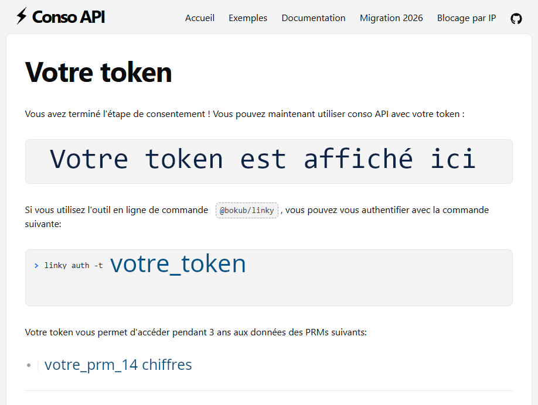

# Plugin Linky pour Domoticz

Plugin [Domoticz](https://domoticz.com) qui récupère les données de votre compteur **Linky** (comptes particuliers) et les stocke dans le log d'un dispositif compteur électrique. Il s'appuie par défaut sur [Conso API](https://conso.boris.sh) (API Enedis « Mesure synchrone V2 », jeton personnel).

Ce dépôt est un **fork maintenu** de [guillaumezin/DomoticzLinky](https://github.com/guillaumezin/DomoticzLinky), dont l'auteur n'utilise plus Domoticz et qui n'est plus maintenu. Le fork ajoute la source Conso API, conserve l'ancien proxy sous le nom « Legacy » (voir [README.legacy](README.legacy)) et vise un usage général, indépendant de tout projet particulier.

- **Notes techniques** : rétroconception du code — paramètres, machine à états, authentification, devices, persistance, sécurité, dette technique : [docs/RETROCONCEPTION.md](docs/RETROCONCEPTION.md).
- **Historique** : [CHANGELOG.md](CHANGELOG.md) (version courante : **3.0.0**).
- **Tests et CI** : le dossier `tests/` contient une suite `pytest` (faux module `Domoticz`, aucun Domoticz requis) ; `ruff.toml` configure un lint minimal. La CI GitHub Actions ([`.github/workflows/ci.yml`](.github/workflows/ci.yml)) exécute `py_compile`, `ruff` et `pytest` sur Python 3.11 et 3.13. En local :

```
python -m pip install -r requirements-dev.txt
python -m py_compile plugin.py
python -m ruff check plugin.py tests
python -m pytest -q
```

*EN: this is a maintained fork of `guillaumezin/DomoticzLinky` (no longer maintained). Since 3.0.0 the default data source is [Conso API](https://conso.boris.sh) (Enedis "Mesure synchrone V2", personal Bearer token, at most 3 requests per day and per meter). The former proxy (Enedis API v5) is kept as the "Legacy" source, documented, with the original English guide, in [README.legacy](README.legacy). This guide is in French.*

Cela ne *fonctionne pas* avec les comptes professionnels : c'est une limitation de l'API Enedis sur laquelle s'appuie le plugin.


En cliquant sur le bouton "Log" :


En cliquant sur le bouton "Rapport" :


## Prérequis
Le plugin a été testé avec la version **2026.4** de Domoticz. La compatibilité avec les versions précédentes n'est pas garantie.

Le framework python 3 doit être installé, suivez le guide https://www.domoticz.com/wiki/Using_Python_plugins, en particulier faites attention à installer la version "dev" si vous ne voyez pas apparaître le plugin dans la liste dans l'onglet de configuration Configuration / Matériel après avoir redémarré Domoticz.

Vérifiez que sont activés les "Événements (Lua/Blockly/Scripts)" dans "Configuration / Paramètres / Autre" :


Vous devez avoir un compteur Linky, créer un compte utilisateur sur [Enedis](http://www.enedis.fr), accepter les conditions d'utilisation et vérifier que vous visualisez bien les courbes sur le site. En particulier, vérifiez la vue par heures (allez sur "Suivre les mesures" et passez "affiché(e)s en" sur "heures"), Enedis peut vous demander la permission la première fois pour collecter et enregistrer les données par heure, ce plugin ne fonctionnera pas pleinement si vous n'avez pas passé cette étape. Vous pouvez activer la collecte et l'enregistrement des données par heure sur votre compte Enedis sur "Gérer l'accès à mes données" dans l'encart "Collecte de la consommation horaire" et dans l'encart "Enregistrement de la consommation horaire". Les données peuvent ne pas être disponibles après l'installation ou l'activation de Linky, soyez patient et vérifiez que vous recevez les données sur le site [Enedis](http://www.enedis.fr) avant de rejetter la faute sur le plugin.

## Installation
Copiez plugin.py dans le sous-répertoire plugins/DomoticzLinky de Domoticz ou placez vous dans le sous répertoire plugins de Domoticz and tapez la commande suivante :
```
git clone https://github.com/vzwingma/DomoticzLinky
```

Pour mettre à jour, écrasez plugin.py ou placez vous dans le sous répertoire plugins de Domoticz et tapez la commande suivante :
```
git pull
```

Redémarrez Domoticz.

Si vous ne voyez pas le plugin dans l'onglet Configuration / Matériel, accordez à tout le monde l'autorisation de lecture du plugin et l'autorisation de lecture et d'exécution du répertoire, pour Linux :
```
cd lerepertoire/plugins
chmod ugo+rx DomoticzLinky
chmod ugo+r DomoticzLinky/plugin.py
```

Redémarrez Domoticz.

Si vous ne recevez pas de données ou obtenez des valeurs incohérentes, en particulier après une mise à jour, revérifiez que sont activés l'enregistrement et la collecte de la consommation horaire sur votre compte Enedis sur "Gérer l'accès à mes données" dans l'encart "Enregistrement de la consommation horaire" et dans l'encart "Collecte de la consommation horaire" et attendez 2 jours.


Si après ça, ce n'est toujours pas bon, il faut effacer le dispositif, et relancer le plugin en cliquant sur le matériel Linky dans les paramètres et en cliquant sur "Modifier", ou relancer Domoticz.


Quand on efface le dispositif ou qu'on met à jour de la version 1 à la version 2 du plugin, on perd l'historique, qu'il est possible de retélécharger sur 730 jours max (en modifiant le paramètre "Nombre de jours à récupérer pour les autres vues" du plugin). Lorsque vous avez récupéré l'historique, n'oubliez pas de redescendre le chiffre à 7 par exemple pour ne pas surcharger les serveurs d'Enedis. Le plugin version 2 ne sait pas récupérer l'historique d'un dispositif du plugin version 1, ce ne sont plus tout à fait les mêmes tables dans la base de données.

Si en récupérant les données, le plugin détecte un dispositif avec seulement des données de consommation, et un autre avec seulement des données de production, il créera un nouveau dispositif fusionnant les données pour faciliter la consultation.

## Configuration
A la première installation, commencez par vérifier dans les paramètres de Domoticz que "Accepter de nouveaux dispositifs matériels" est activé au moins temporairement (Configuration / Paramètres / Système / Matériel/dispositifs).


Ajoutez le matériel Linky dans l'onglet de configuration Configuration / Matériel, puis renseignez la source des données, le PRM et le jeton comme décrit dans [Configurer Conso API](#configurer-conso-api).


Vous pouvez configurer les tarifs heures pleines (Coûts T1 pour la consommation et R1 pour la production) et heures creuses (Coûts T2 pour la consommation et R2 pour la production) dans le menu Configuration / Paramètres / Sondes/Compteurs. Dans ce menu, vérifiez que "Electricité" est bien mis à 1000.


Dans ce même menu, en bas, vérifiez que "P1 Smart Meter" est bien de type "Avec des décimales".


### Source des données (v3.0.0)

Le paramètre **« Source des données »** choisit d'où viennent les mesures :

| Choix | Service | Authentification | Remarques |
|---|---|---|---|
| **Conso API** (défaut) | [conso.boris.sh](https://conso.boris.sh) — API Enedis « Mesure synchrone V2 » | jeton personnel saisi dans le matériel | source recommandée ; pas de production |
| **Legacy** | ancien proxy d'authentification (API Enedis v5, en fin de vie) | consentement dans le log Domoticz | conservée en repli ; production disponible ; configuration, hébergement et consentement : [README.legacy](README.legacy) |

#### Configurer Conso API

1. Rendez-vous sur [conso.boris.sh](https://conso.boris.sh) et suivez la procédure de **consentement** Enedis (connexion à votre espace client Enedis). Vous obtenez un **jeton** (une longue chaîne `xxx.yyy.zzz`), valable **3 ans**. À la fin du consentement, la page affiche votre jeton et les PRM auxquels il donne accès :

   
2. Notez votre **PRM** (numéro de point de livraison, 14 chiffres, visible sur votre espace client Enedis ou sur le compteur).
3. Dans Domoticz / Configuration / Matériel, sur le matériel Linky :
   - « Source des données » = **Conso API** ;
   - « Conso API : PRM » = votre PRM (plusieurs PRM : séparez-les par des virgules) ;
   - « Conso API : jeton » = le jeton obtenu à l'étape 1 (champ masqué) ;
   - cliquez sur **Modifier**.


   
4. Au démarrage, le log indique « Source des données : Conso API ». Si le jeton est vide ou si un PRM ne fait pas 14 chiffres, le plugin s'arrête avec un message d'erreur et **n'envoie aucune requête**.

**Révocation** : vous pouvez retirer l'accès à tout moment depuis votre espace client Enedis (rubrique de gestion du partage de vos données). Le plugin affichera alors « Jeton Conso API invalide ou expiré » ; refaites l'étape 1 et remplacez le jeton.

**Le jeton est un secret** : il est stocké par Domoticz dans sa base (`domoticz.db`, non chiffrée) et masqué (`***`) dans les journaux du plugin. Ne le partagez pas.

#### Quota d'appels (Conso API)

Conso API est un service gratuit dont le quota Enedis est partagé par tous ses utilisateurs ; un usage abusif entraîne un **blocage de l'adresse IP pendant plusieurs mois, sans recours** ([règles d'usage](https://conso.boris.sh/blocage-ip)). Le plugin applique donc :

- **au plus 3 requêtes par jour et par PRM**, retries compris (compteur conservé même après un redémarrage de Domoticz) ;
- un cycle par jour, vers 8 h (minutes aléatoires) : **2 requêtes** (courbe de charge des 7 derniers jours + puissance maximale) ;
- en cas d'erreur temporaire (service indisponible, délai dépassé) ou si les données de la veille ne sont pas encore publiées : **une seule** nouvelle tentative 3 h plus tard (avant 22 h), sinon le lendemain ;
- jeton refusé (401/403) ou requête invalide (400) : pas de nouvelle tentative avant le lendemain ;
- historique long (« Nombre de jours à récupérer pour les autres vues » > 7) : récupéré **progressivement, un lot par jour** ; un trou dans l'historique se comble donc en plusieurs jours ;
- aucune requête au redémarrage si le cycle du jour a déjà réussi ; jamais de requêtes en parallèle.

Les données d'un jour J sont publiées par Enedis vers 8 h à J+1 (parfois 1 à 2 h plus tard).

#### Migration depuis la version 2.x

La version 3.0.0 est **incompatible** : après la mise à jour, le plugin démarre en mode Conso API et s'arrête avec « le jeton … est vide » tant que le matériel n'est pas reconfiguré.

1. Obtenez le jeton Conso API (voir ci-dessus).
2. Ouvrez le matériel Linky (Configuration / Matériel), renseignez « Source des données » = Conso API, le PRM et le jeton, vérifiez que « Debug » = Non, puis **Modifier**.
3. Les devices `Linky <PRM>` existants sont réutilisés (même `idx`, historique conservé). Il n'y a **pas de rattrapage** des jours manqués avant la migration au-delà de l'historique configuré.
4. Pour revenir à l'ancien fonctionnement : « Source des données » = **Legacy** (voir [README.legacy](README.legacy)).

### Heures creuses
Vous pouvez remplir le champ "Heures creuses" pour choisir les plages horaires d'heures ("Utilisation 2" dans les courbes), ou laisser vide pour désactiver, voici des exemples :

```
2h00-7h00 13h00-16h00
```
configure les heures creuses de 2h à 7h et de 13h à 16h.

```
2h00-7h00 13h00-16h00 mercredi 08h00-15h00 samedi 09h00-11h00 12h00-16h00
```
configure les heures creuses de 8h à 15 le mercredi, de 9h à 11h et de 12h à 16h le samedi et de 2h à 7h et de 13h à 16h les autres jours de la semaine.

```
2h00-7h00 13h00-16h00 me 08h00-15h00 sa 09h00-16h00
```
configure les heures creuses de 8h à 15 le mercredi, de 9h à 16h le samedi et de 2h à 7h et de 13h à 16h les autres jours de la semaine.

```
12345678901234 1h00-6h00 12h00-14h00 88888888888888 13h00-16h00
```
configure les heures creuses pour les plages horaires "1h00-6h00 12h00-14h00" pour le point de livraison "12345678901234" et la plage horaire "13h00-16h00" pour le point de livraison "88888888888888".

```
02h00-04h00 16h00-19h00 12345678901234 1h00-6h00 12h00-14h00 mercredi 11h00-16h00 88888888888888 13h00-16h00
```
configure les heures creuses pour la plage horaire "11h00-16h00" le mercredi et "1h00-6h00 12h00-14h00" pour les autres jours de la semaine pour le point de livraison "12345678901234", la plage horaire "13h00-16h00" pour le point de livraison "88888888888888" et les plages horaires "02h00-04h00 16h00-19h00" pour tous les autres points de livraison.

```
02h00-04h00 16h00-19h00 12345678901234 88888888888888 13h00-16h00
```
désactive les heures creuses pour le point de livraison 12345678901234, configure les heures creuses pour la plage horaire "13h00-16h00" pour le point de livraison "88888888888888" et les plages horaires "02h00-04h00 16h00-19h00" pour tous les autres points de livraison.

```
02h00-04h00 16h00-19h00 P 17h00-22h00 mercredi 11h00-16h00 12345678901234 88888888888888 13h00-16h00
```
désactive les heures creuses pour le point de livraison 12345678901234, configure les heures creuses pour la plage horaire "13h00-16h00" pour le point de livraison "88888888888888" et les plages horaires "02h00-04h00 16h00-19h00" en consommation et "11h00-16h00" le mercredi et "17h00-22h00" pour les autres jours de la semaine en production pour tous les autres points de livraison.

```
02h00-04h00 16h00-19h00 P
```
configure les heures creuses pour les plages horaires "02h00-04h00 16h00-19h00" en consommation et désactive les heures creuses en production pour tous les points de livraison.

```
02h00-04h00 sa 00h00-23h59 di 00h00-23h59 fe 00h00-23h59
```
configure les heures creuses pour la plage horaire "02h00-04h00", pour le week-end et pour les jours fériés.

Pour appliquer les heures creuses aux anciennes données, passez le paramètre "Debug" à "Reset cache" et cliquez sur "Modifier", puis remettez "Debug" à son ancienne position et refaites "Modifier". 

### Ordre des index
Par défaut, le plugin range les heures pleines dans "Utilisation 1" (Coûts T1) et les heures creuses dans "Utilisation 2" (Coûts T2). Domoticz n'impose pas d'ordre, et d'autres compteurs font l'inverse (par exemple un TICMeter via le plugin Zigbee for Domoticz). Le paramètre "Ordre des index" permet de choisir "Heures creuses puis heures pleines" pour que tous vos compteurs utilisent le même ordre, et donc les mêmes coûts T1 / T2.

Attention : ce choix ne modifie pas l'historique déjà enregistré. Pour un historique cohérent, changez-le avant de récupérer l'historique, ou effacez le dispositif et retéléchargez l'historique (voir plus haut).

### Affichage
Vous pouvez choisir le nombre à afficher sur le tableau de bord :


* sur la première ligne : il s'agit d'un pic de consommation instantané (Watt). Cette ligne correspond au paramètre "Consommation à montrer sur le tableau de bord (affichage principal)" du plugin

* sur les lignes suivantes : il s'agit d'une énergie consommée (kWh). La valeur "Aujourd'hui" qui précède reste à 0, c'est normal car Enedis ne fournit que la valeur de la veille. Ces lignes correspondent au paramètre "Consommation à montrer sur le tableau de bord (affichage secondaire)" du plugin. Ces lignes n'apparaîtront pas sur le tableau de bord principal (onglet Accueil), seulement dans l'onglet Mesures

### Nombre de jours à récupérer
* Vous pouvez choisir le nombre de jours à récupérer pour la vue par heures. Vous pouvez mettre le nombre de jours à récupérer à 0 pour désactiver la récupération de données pour la vue par heures. Notez que Domoticz effacera chaque jour une partie des données de la vue par heures en se basant sur le paramètre Log des capteurs qui se trouve dans Configuration / Paramètres / Historique des logs, vous pouvez augmenter ce paramètre pour voir jusqu'à 7 jours d'historique


* Vous pouvez choisir le nombre de jours à récupérer pour les autres vues. Si la valeur est supérieur à 35, le plugin ne fera la récupération que de temps en temps ou quand le paramètre est modifié, pour ne pas surcharger les serveurs d'Enedis. Une fois les données récupérées, elles sont stockées et persistent dans la base de données de Domoticz

## Paramètres du plugin
Cette section résume les paramètres affichés dans Configuration / Matériel pour le plugin Linky (les noms techniques `Mode1` à `Mode6` et `Port` sont ceux que Domoticz utilise en interne et que reprend la [documentation technique](docs/RETROCONCEPTION.md#3-paramètres-du-plugin)). Les valeurs hors bornes sont ramenées aux bornes au démarrage du plugin.

| Paramètre | Libellé affiché dans Domoticz | Rôle | Valeurs | Défaut |
|---|---|---|---|---|
| `Address` | « Source des données » | Source des mesures (voir [Source des données](#source-des-données-v300)) | « Conso API » (`consoapi`) ou « Legacy » (`legacy`) ; vide = Conso API | Conso API |
| `Username` | « Conso API : PRM (14 chiffres, plusieurs séparés par des virgules) » | PRM interrogé(s) en mode Conso API (ignoré en Legacy, qui reçoit la liste du proxy) | un ou plusieurs numéros de 14 chiffres | vide |
| `Password` | « Conso API : jeton (Bearer) » | Jeton Conso API (champ masqué, ignoré en Legacy) | chaîne fournie par conso.boris.sh | vide |
| `Mode1` | « Nombre de jours à récupérer pour la vue par heures (0 min, pour désactiver la récupération par heures, 7 max) » | Profondeur de l'historique de la vue par heures (voir [Nombre de jours à récupérer](#nombre-de-jours-à-récupérer)) | entier de 0 à 7 ; `0` désactive la vue par heures ; valeur invalide : 7 | 7 |
| `Mode2` | « Nombre de jours à récupérer pour les autres vues (730 max) » | Profondeur de l'historique des vues jour / semaine / mois / année | entier de 2 à 730 ; relevé automatiquement selon l'affichage secondaire (`Mode6`) : semaine en cours 7, semaine dernière 14, mois en cours 32, mois dernier 63, année en cours 366 ; au-delà de 35 jours, la récupération complète n'a lieu que de temps en temps | 7 |
| `Mode3` | « Debug » | Debug et maintenance (voir le tableau ci-dessous) | Non, Simple, Avancé, effacer le consentement Legacy, vider le cache | Non |
| `Mode4` | « Heures creuses (vide pour désactiver, cf. readme pour la syntaxe) » | Plages d'heures creuses (voir [Heures creuses](#heures-creuses)) | texte, syntaxe décrite dans [Heures creuses](#heures-creuses) ; vide = désactivé | vide |
| `Mode5` | « Consommation à montrer sur le tableau de bord (affichage principal) » | Pic de consommation affiché sur la première ligne du dispositif (voir [Affichage](#affichage)) | pic de consommation de la journée dernière, de la semaine en cours / dernière, du mois en cours / dernier, de l'année en cours | aucune valeur par défaut dans la liste ; sans choix, le plugin utilise « Pic consommation journée dernière » |
| `Mode6` | « Consommation à montrer sur le tableau de bord (affichage secondaire) » | Énergie affichée sur les lignes suivantes du dispositif | consommation / production, ou horaire maximale, ou horaire moyenne, de la journée dernière, de la semaine en cours / dernière, du mois en cours | « Consommation / production journée dernière » |
| `Port` | « Ordre des index (Utilisation 1 / Utilisation 2) » | Ordre heures pleines / heures creuses (voir [Ordre des index](#ordre-des-index)) ; le champ `Port` est réutilisé, ce n'est pas un port réseau | « Heures pleines puis heures creuses » ou « Heures creuses puis heures pleines » | Heures pleines puis heures creuses |

### Effets du paramètre « Debug » (`Mode3`)

| Choix affiché | Valeur | Effet |
|---|---|---|
| Non | 0 | Aucun debug. |
| Simple (fichier de log dans /tmp) | 1 | Crée un fichier de debug dans `/tmp` (voir ci-dessous) ; les messages de debug ne vont que dans ce fichier, pas dans le log Domoticz. |
| Avancé (fichier de log + debug Domoticz) | 2 | Fichier de debug **et** messages de debug recopiés dans le log Domoticz, **avec le debug complet du framework Domoticz** (voir l'avertissement ci-dessous). |
| Legacy : effacer consentement et jetons, puis remettre Non | 3 | À **chaque démarrage** tant que ce choix est sélectionné, le plugin efface les jetons de la source Legacy : un nouveau consentement est demandé (voir [Obtention du consentement](README.legacy#obtention-du-consentement)). Sans effet sur le jeton Conso API (paramètre du matériel). Active aussi le debug avancé. |
| Vider le cache des données, puis remettre Non | 4 | À **chaque démarrage** tant que ce choix est sélectionné, le plugin vide son cache : les données sont redemandées à Enedis à la prochaine collecte (utile pour appliquer les heures creuses aux anciennes données). Active aussi le debug avancé. |

Les anciennes options « Faux client 0 à 9 » (serveur de test) ont été supprimées en 3.0.0. Après un effacement du consentement ou du cache, remettez « Debug » sur sa valeur précédente (en général « Non ») et cliquez sur « Modifier », sinon l'opération se répète à chaque redémarrage de Domoticz.

> ⚠️ **Debug = fichiers `/tmp`** : dès « Simple », le plugin écrit un fichier `/tmp/DomoticzLinky_<date>_<aléa>.log` (dans le conteneur si Domoticz tourne sous Docker). Son chemin est indiqué dans le log Domoticz au démarrage. Il est fermé à l'arrêt du plugin mais **n'est jamais supprimé automatiquement** : supprimez-le vous-même quand vous n'en avez plus besoin. Depuis la version 2.7.0, les jetons, les en-têtes `Authorization` et les cookies y sont masqués (`***`), ainsi que le jeton Conso API depuis la 3.0.0 ; en revanche, votre numéro de point de livraison (PRM) et le code de consentement y apparaissent en clair : relisez le fichier avant de le transmettre à quelqu'un.

> ⚠️ **Avertissement — debug avancé (connu, non corrigé)** : tous les choix de « Debug » **à partir d'« Avancé »** (Avancé, effacement du consentement, vidage du cache) activent le **debug complet du framework Domoticz**. Ce debug n'est pas filtré par le plugin et peut écrire **les jetons en clair dans le log Domoticz** (en-tête `Bearer` — y compris le jeton Conso API —, `refresh_token`, réponse d'obtention des jetons). N'activez ces choix que **ponctuellement**, puis remettez « Debug » sur « Non » et **purgez le log Domoticz** (Configuration / Log, ou le fichier de log de Domoticz). Le choix « Simple » n'est pas concerné. Détail technique : [docs/RETROCONCEPTION.md](docs/RETROCONCEPTION.md#3-paramètres-du-plugin) (§ 3, effets de `Mode3`) et § 13 (sécurité, risque S9 / D17).

## Dépannage
### Etat des services
Commencez par consulter l'[état des services Enedis](https://datahub-enedis.fr/services-api/etat-des-services/). En cas d'erreur, le plugin ne pourra pas fonctionner non plus, il faudra attendre le rétablissement des services.

### Conso API : « Jeton Conso API invalide ou expiré »
Le jeton est erroné, a expiré (3 ans) ou a été révoqué dans l'espace client Enedis, ou il ne donne pas accès à ce PRM. Vérifiez le PRM, refaites le consentement sur [conso.boris.sh](https://conso.boris.sh) et remplacez le jeton dans le matériel. Le plugin ne réessaie pas avant le lendemain.

### Conso API : « Budget Conso API du jour atteint »
Les 3 requêtes du jour pour ce PRM ont été utilisées (erreurs répétées ou historique en cours de récupération). Le plugin reprend automatiquement le lendemain ; ne redémarrez pas le matériel en boucle, cela ne débloque rien. Si cela se répète, mettez « Debug » sur « Simple » un jour pour comprendre la cause.

### Conso API : « … nouvelle tentative plus tard »
Service Conso API ou Enedis indisponible (429, 5xx) ou délai de réponse dépassé : une seule nouvelle tentative a lieu 3 h plus tard, sinon le lendemain.

### Les courbes affichent les données en jour de la semaine, du mois et de l'année mais pas les données en heures
Vérifiez que vous avez bien suivi toutes les étapes du menu [Configuration](#configuration).

### Erreur "Données manquantes pour mettre à jour le tableau de bord"
Cette erreur est liée à des données manquantes pour satisfaire les configurations d'affichage "Consommation à montrer sur le tableau de bord". Cette erreur doit être transitoire. Si elle persiste plusieurs jours de suite, essayez de changer la configuration "Consommation à montrer sur le tableau de bord". Si cela persiste encore, ouvrez une demande de support.

### Erreur "Serveurs inaccessibles à cette heure"
Les serveurs d'Enedis sont inaccessibles la nuit, le plugin va de lui-même ré-essayer de récupérer vos données le lendemain matin après 8h.

### Source Legacy
Les erreurs propres à la source Legacy (« Trop d'échecs de communication », consentement) sont décrites dans [README.legacy](README.legacy#dépannage-source-legacy).

### Les problèmes persistent
Passez le paramètre "Debug" à "Simple" et cliquez sur "Modifier". Observez le log de Domoticz, il vous indiquera le chemin vers un fichier log spécifique au plugin, par exemple /tmp/DomoticzLinky_2021_01_17_15_04_19_ukzvik3k.log. Ouvrez ce fichier avec un éditeur de texte pour voir ce qui se trame. Si vous n'y comprenez rien, ouvrez un ticket de support sur https://github.com/vzwingma/DomoticzLinky/issues en décrivant le problème, sans y joindre le fichier de log brut (il contient votre PRM).

## Auteurs
* **Baptiste Candellier** - *Kindle Linky plugin* - [linkindle](https://github.com/outadoc/linkindle)
* **Asdepique777** - *Jeedom Linky plugin* - [jeedom_linky](https://github.com/Asdepique777/jeedom_linky)
* **epierre** - *Linky external script for Domoticz* - [domoticz_linky](https://github.com/empierre/domoticz_linky)
* **Guillaume Zin** ([guillaumezin](https://github.com/guillaumezin)) - *Auteur du plugin d'origine : portage vers le plugin framework de Domoticz et adaptation du code de Device Flow Proxy Server pour Enedis* - [DomoticzLinky](https://github.com/guillaumezin/DomoticzLinky) et [DomoticzFlowProxyServer](https://github.com/guillaumezin/Device-Flow-Proxy-Server)
* **vzwingma** ([GitHub](https://github.com/vzwingma)) - *Maintenance du fork, source Conso API (v3.0.0)* - [DomoticzLinky](https://github.com/vzwingma/DomoticzLinky)
* **Frédéric Caillet** - *Contractualisation, maintenance et hébergement du code de Device Flow Proxy Server pour Enedis* - [DomoticzFlowProxyServer](https://github.com/russandol-sarl/Device-Flow-Proxy-Server)

Voir aussi la liste des [contributeurs](https://github.com/guillaumezin/DomoticzLinky/contributors) du projet d'origine.

## Licence
Ce projet est sous licence AGPLv3 - cf. fichier [LICENSE](LICENSE) pour plus de détails.

## Remerciements
* Guillaume Zin ([guillaumezin](https://github.com/guillaumezin)) - pour le plugin d'origine, publié sous licence AGPLv3, sur lequel ce fork repose
* Conso API ([conso.boris.sh](https://conso.boris.sh)) - pour le service gratuit qui donne accès aux données Enedis
* Frédéric Caillet - son site Internet : [RUSSANDOL](https://www.russandol.pro) - pour l'hébergement et la maintenance de l'ancienne infrastructure intermédiaire d'obtention du consentement oAuth et la prise en charge contractuelle avec Enedis
* Baptiste Candellier
* Asdepique777
* empierre
* Domoticz team
